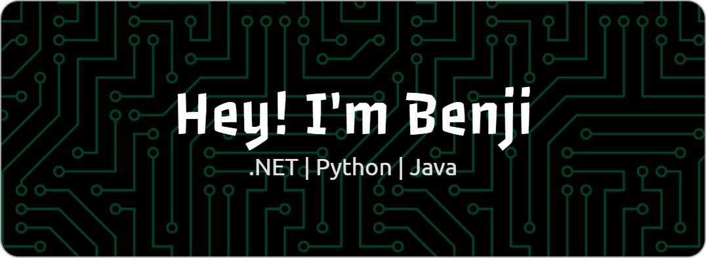

# Hi, I'm Benji Diaz! 👋

TODO: Badges

## About Me

During the day I work as a NOC Technician. But behind that mask, I'm an Engineer starting his career as a Developer by building projecs brick by brick 🧱. 
(Or is it more accurate to say line by line? 🤔)

Back in 2019, I joined the Robotics team at Highlands International School San Salvador 🇸🇻. Since then, my pasion for Mathematics, Robotics, Technology and Engineering grew exponentialy. Later, I decided on hopping on the Tech World by pairing my B.S. in Computer Science along with Minors in Maths and Physics at Augusta University (Go Jags! 🐾).

So yeah, I can proubdly say I'm a nerd Pro Max! ⚡

If you would like to know more about my interests go here (TODO: add more of my interests in about me)

## My Projects & Activity

TODO: Add Projecs and Recent Activity

## Contact Me

TODO: Add Social Media and contact Info
